# venderian

an android app (kotlin, jetpack compose, material 3) that teaches venderian, a made-up language with its own angular script, plus a keyboard that turns english into venderian glyphs. offline, no accounts, no ads.

**install:** [`dist/venderian.apk`](dist/venderian.apk) (android 8+)

| learn | lesson | practice | quiz | keyboard | english → venderian | progress |
|---|---|---|---|---|---|---|
| 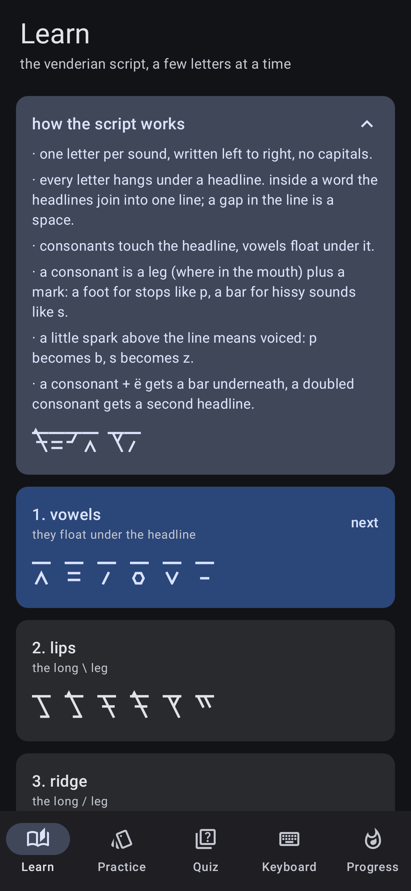 | 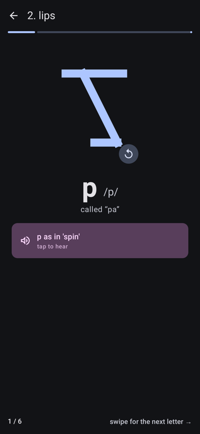 | 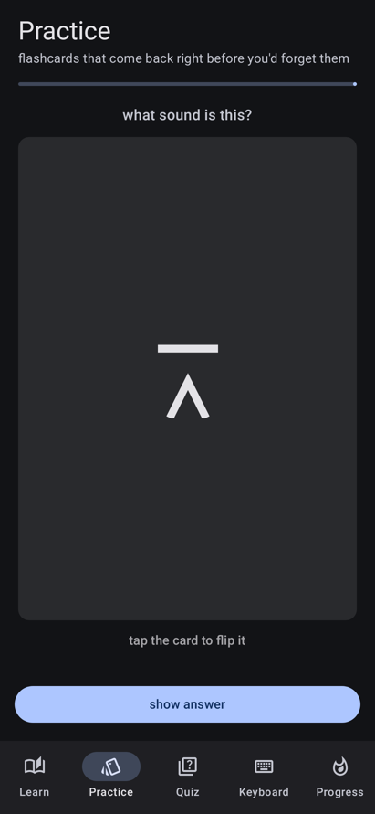 | 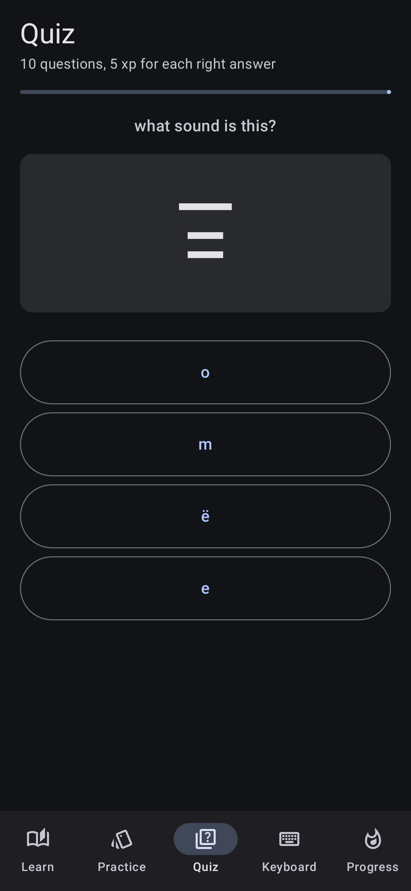 | 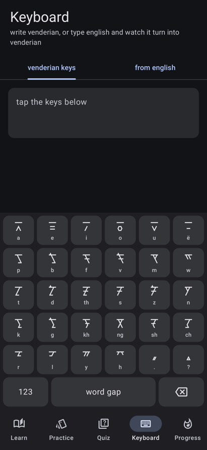 | 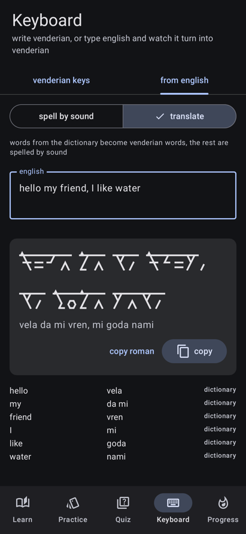 | 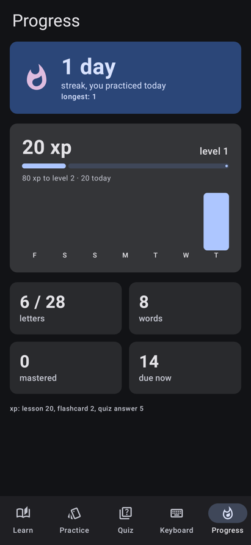 |

| system keyboard: english | system keyboard: venderian |
|---|---|
| 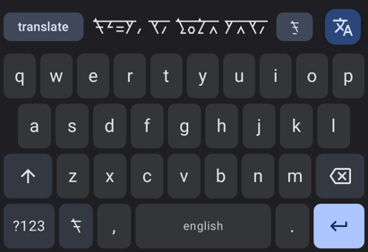 | 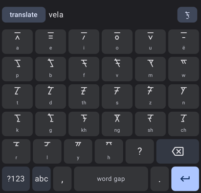 |

| course | grammar tip | build a sentence | match |
|---|---|---|---|
| 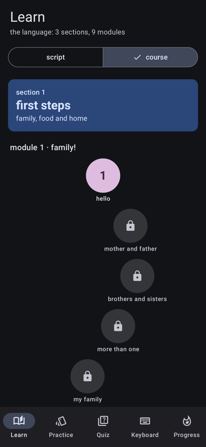 | 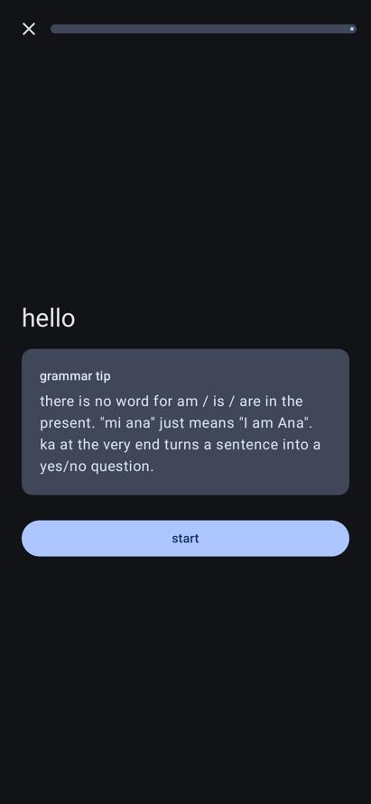 | 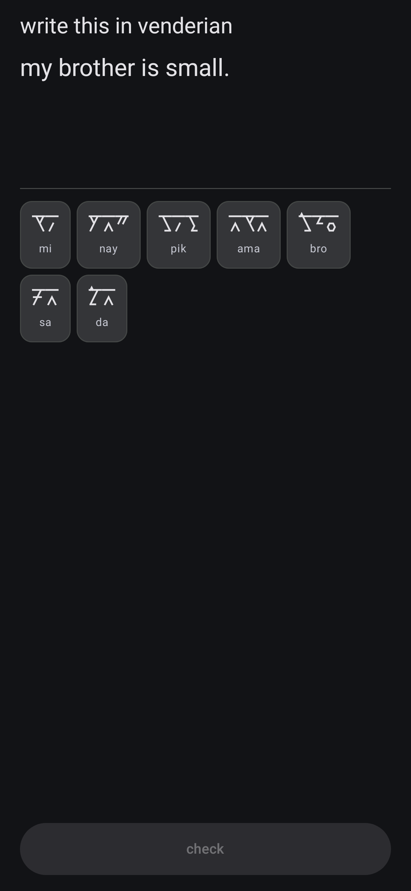 | 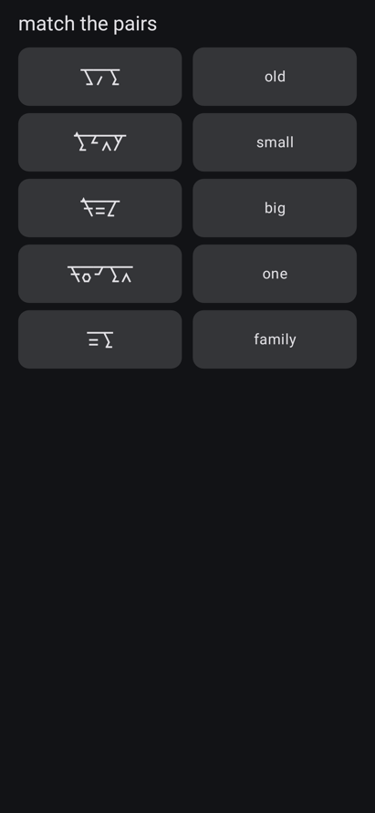 |

built in stages:

1. **language design** (done): [`docs/venderian.md`](docs/venderian.md) is the source of truth, glyph strokes are in [`docs/alphabet.json`](docs/alphabet.json), the starter dictionary is [`app/src/main/assets/dictionary.json`](app/src/main/assets/dictionary.json)
2. **font** (done): svg glyphs in `glyphs/`, built into [`app/src/main/res/font/venderian.ttf`](app/src/main/res/font/venderian.ttf) with ligatures as an opentype `liga` feature
3. **converter** (done): english → phonemes (cmudict, or spelling rules for unknown words) → venderian glyphs, plus a translate mode that uses the dictionary. code in `app/src/main/java/app/venderian/convert/`, tests with `./gradlew :app:testDebugUnitTest`
4. **the app** (done):
   - **learn, script**: 5 alphabet lessons grouped by letter family, stroke order animation for every letter, tap-to-hear sound hints (the phone's offline text to speech)
   - **learn, course** (opens once the script is done): 3 sections × 3 modules. each module is module N (5 lessons), a challenge (3 hearts, to lock it in), then module N.5 (5 more lessons) and a gold lesson: 90 lessons, 9 challenges, 9 gold lessons. exercises: new words, pick the meaning, match pairs, build sentences from word tiles both ways, and read the script and type it. grammar builds up from "mi ana" to if / because / when, who / that clauses and opinions. the course lives in [`course/`](course) and is checked and built by `tools/make_course.py`
   - **practice**: flashcards both ways (glyph ↔ sound, word ↔ meaning) with sm-2 spaced repetition in room. script lessons add their letters, course lessons add their words
   - **quiz**: 10 questions, only about what you've learned: letters, reading words made of letters you know, and words from finished course lessons
   - **system keyboard** (works in every app, turn it on from the keyboard tab): a qwerty layout with a strip that shows your english as venderian while you type, and a translate button that swaps it in (tap again to undo). a second layout has the venderian glyph keys for writing it directly. the strip switches between translate / spell by sound, and between writing the script or its romanization (other apps don't have the venderian font, so the script shows up as boxes there). the image button sends it as a picture (script + roman underneath) to apps that take images from keyboards, or through the share sheet
   - **keyboard tab**: the same thing inside the app, with copy buttons
   - **progress**: streak, xp and levels, the last 7 days, letters and words learned

## building

needs jdk 17+ and the android sdk. `./gradlew assembleDebug` builds the app, `./gradlew :app:testDebugUnitTest` runs the tests (converter, spaced repetition, and robolectric screenshots of every screen into `app/build/outputs/roborazzi/`).

## tools

- `python3 tools/render_chart.py` redraws `docs/alphabet.svg` from `docs/alphabet.json`
- `python3 tools/make_course.py` checks the course (every word taught before it's used, endings attach right, new words follow the sound rules) and writes `course.json` and the full `dictionary.json`
- `python3 tools/make_cmudict.py` rebuilds `app/src/main/assets/cmudict.dat` from [cmudict](https://github.com/cmusphinx/cmudict) (bsd license, carnegie mellon university)
- `python3 tools/make_glyphs.py && python3 tools/build_font.py` redraws `glyphs/*.svg` and rebuilds the font (needs `pip install -r tools/requirements.txt`)
