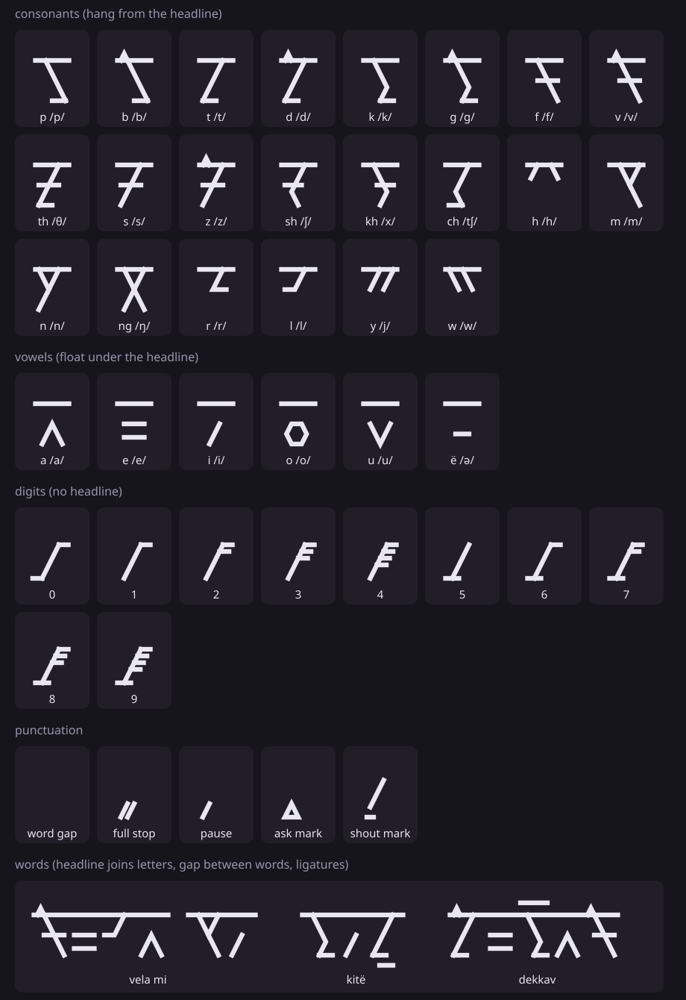

# venderian

venderian (native name **vendëri**, said VEN-dë-ri) is a made-up language with its own angular script. this file is the source of truth for the language. the app, the font and the converter all follow it.

- glyph strokes: [`alphabet.json`](alphabet.json) (rendered as [`alphabet.svg`](alphabet.svg) by `tools/render_chart.py`)
- dictionary: [`app/src/main/assets/dictionary.json`](../app/src/main/assets/dictionary.json), generated by `tools/make_dictionary.py`, which also checks every word against the rules below

## 1. sounds

### consonants (22)

|              | lips  | teeth/ridge | palate | back of mouth | throat |
|--------------|-------|-------------|--------|---------------|--------|
| stops        | p  b  | t  d        |        | k  g          |        |
| fricatives   | f  v  | th  s  z    | sh     | kh            | h      |
| affricate    |       |             | ch     |               |        |
| nasals       | m     | n           |        | ng            |        |
| liquids      |       | r  l        |        |               |        |
| glides       | w     |             | y      |               |        |

- `th` is always the voiceless sound of "thin", never "this"
- `kh` is the rough sound of scottish "loch" / russian х
- `r` is a single tap, like spanish "pero"
- `ng` is one sound, as in "sing". if you ever need n followed by g, write `n'g` in romanization

### vowels (6)

| letter | sound | like |
|--------|-------|------|
| a | /a/ | father |
| e | /e/ | bed |
| i | /i/ | machine |
| o | /o/ | more |
| u | /u/ | rule |
| ë | /ə/ | the "uh" in sofa |

diphthongs are a vowel followed by a glide letter: `ay`, `ey`, `oy`, `aw`, `ow`. they are spelled with two glyphs, but count as one syllable.

### syllables

a native syllable is `(s)(C)(G)V(C)`:

- `C` is any consonant, `G` is a glide or liquid (`r l y w`), `V` is a vowel
- `s` can stand in front of a word-initial onset: `stel`, `skol`, `skri`
- at most one consonant at the end of a syllable, so `kar` is fine but `kard` is not
- a word can't end in a cluster. inside a word, a consonant run splits as one coda + a legal onset: `ay.da`, `pos.dey`, `dek.kav`

foreign words (and anything the english converter spells) may break these rules. the script can write any sequence, the rules only apply to real venderian words.

### stress

stress goes on the **second-to-last syllable**, and one-syllable words carry their own stress. it is never written. examples: `VE-la`, `SHE-van`, `RU-ma`, and `LER-na` → `ler-NA-ta` (a suffix moves the stress, because it always counts from the end).

## 2. the script

one glyph per sound, not per english letter. 22 consonants + 6 vowels = 28 letters, written left to right. there are no capital letters.

the shapes are built only from straight strokes on a small grid: consonants are 4 wide and 6 tall, vowels are 4 wide and 4 tall, so you can tell vowels apart at a glance because they are shorter.

### the voicing roof

voiced consonants are their voiceless partner plus a flat **roof** stroke on top:

| voiceless | voiced (+ roof) |
|-----------|-----------------|
| p | b |
| t | d |
| k | g |
| f | v |
| s | z |

learn 5 shapes, get 10 letters. the other consonants have no roof, so a top bar always means "voiced".

### family resemblances

- `s` is a `<`, `sh` is `s` with a middle tongue stroke, `z` is `s` with the roof
- `k` is a `V`, `kh` is `k` with a stem inside it, `g` is `k` with the roof
- `n` is a diamond, `ng` is the diamond split by a stem
- `m` is a closed triangle. closed shapes are always nasals or `o`

### letter names

consonants are named with an `a`: pa, ba, ta, ..., wa. vowels are named by their sound. the app uses the name plus the `hint` from `alphabet.json` as the tap-to-hear sound hint.

### stroke order

the order of strokes in `alphabet.json` is the stroke order, and each stroke is drawn from its first point to its last. general habits: stems before branches, top to bottom, left to right, the roof last.

### digits

numbers are base ten, written biggest place first, left to right, just like 0-9. every digit is a stem with ticks:

- `0` is the stem with a top and bottom bar (an I-beam)
- `1` to `4`: the stem with 1 to 4 ticks hanging off the right
- `5` is the stem with a left foot
- `6` to `9`: the left foot plus 1 to 4 ticks

so a digit is `foot (5) + number of ticks`.

number words: `zen` 0, `ek` 1, `dor` 2, `tis` 3, `kav` 4, `pam` 5, `shel` 6, `sib` 7, `okh` 8, `nir` 9, `dek` 10. bigger numbers are built with `dek`: `dekkav` 14 (ten-four), `dordek` 20 (two-ten), `dordekek` 21.

### punctuation

| mark | name | used for |
|------|------|----------|
| short slash | word mark | between every two words (this is how a space is written) |
| double bar | full stop | end of a sentence |
| angled hook | pause | where english uses a comma |
| small closed triangle | ask mark | end of a question (optional after `ka`) |
| tall T | shout mark | end of an exclamation |

## 3. spelling rules

1. **spell sounds, not letters.** english `phone` → `fown`, `cat` → `kat`
2. **diphthongs** are written vowel + glide: `ay` = `a` + `y`
3. **schwa fusion (ligature).** a consonant followed by `ë` fuses into one glyph: the consonant with a bar under the baseline. `kitë` is written with 3 glyphs: `k`, `i`, `t+ë`. the `ë` glyph on its own only appears at the start of a word or after a vowel
4. **doubling (ligature).** two of the same consonant in a row fuse into one glyph with two small ticks above it: `dekkav` → `d`, `e`, `kk`, `a`, `v`. doubled consonants are said a little longer
5. if both apply (`kkë`), doubling first, then the schwa bar is added to the doubled glyph
6. the **word mark** separates words. sentence marks replace the word mark at the end of a sentence
7. no capitals, no silent letters, ever

the ligatures are font features (opentype `liga`), so the text itself still stores one character per sound.

## 4. grammar

### word order

**subject, object, verb** (SOV). the verb always comes last.

> mi nami sipa — I water drink — "I drink water"

### nouns

- plural: add `-an` after a consonant, `-n` after a vowel. `vuf` → `vufan` (dogs), `kitë` → `kitën` (books), `hum` → `human` (people)
- no articles. `kar` is "house", "a house" or "the house"
- adjectives follow the noun: `kar gran` (big house), `vufan rud` (red dogs). plural goes on the noun only
- possession with `da` (of): `kar da mi` (my house), `ishe da tu` (your name)
- prepositions come before the noun: `un kar` (in the house), `ra skol` (to school)

### pronouns

| | singular | plural |
|---|---|---|
| 1st | mi | min |
| 2nd | tu | tun |
| 3rd | sa (he, she, it) | san |

pronouns follow the noun plural rule. `sa` has no gender.

### verbs

verbs don't change for person. tense is a suffix:

| tense | suffix | example |
|-------|--------|---------|
| present | (none) | `yama` eat / eats |
| past | `-ta` | `yamata` ate |
| future | `-va` | `yamava` will eat |

`es` (to be) is often dropped in the present: `kar gran` can mean "the house is big".

### negation

`ne` right before the verb: `mi mish ne goda` — "I don't like cats".

### questions

- yes/no questions: put `ka` at the very end. `tu nami sipata ka?` — "did you drink water?"
- question words (`kwo` what, `kwi` who, `kwe` where, `kwan` when, `kwu` how, `kwa` why) go where the answer would go, no `ka` needed: `tu kwo yamava?` — "what will you eat?"

### example sentences

| venderian | word for word | english |
|-----------|---------------|---------|
| vela! ishe da mi ana. | hello! name of me ana. | hello! my name is ana. |
| mi thelor vendëri lerna. | I language venderian learn | I'm learning venderian. |
| tu kitë ridëva ka? | you book read-FUT Q | will you read the book? |
| san kar gran ne ha. | they house big not have | they don't have a big house. |
| vedey sol kal. | today sun hot | the sun is hot today. |
| min ra skol pasata. | we to school walk-PAST | we walked to school. |

## 5. english → venderian (the converter)

the converter turns english text into venderian glyphs in three steps: english word → phonemes (via cmudict, or the fallback letter rules for unknown words) → venderian sounds → glyph string. this table maps the cmudict (arpabet) phonemes:

| arpabet | venderian | | arpabet | venderian |
|---|---|---|---|---|
| AA, AE | a | | B | b |
| AH (stressed) | a | | CH, JH | ch |
| AH (unstressed) | ë | | D | d |
| AO | o | | DH, TH | th |
| AW | aw | | F | f |
| AY | ay | | G | g |
| EH | e | | HH | h |
| ER | ër | | K | k |
| EY | ey | | L, M, N, NG | l, m, n, ng |
| IH, IY | i | | P | p |
| OW | ow | | R | r |
| OY | oy | | S, SH | s, sh |
| UH, UW | u | | T, V, W, Y, Z | t, v, w, y, z |
| | | | ZH | sh |

**translate mode** first looks each word up in the dictionary (english meaning → venderian word, so "water" → `nami`) and spells out every word it doesn't know phonetically with the table above. it does not reorder words or conjugate, it is a word-by-word helper.

## 6. text encoding

venderian letters live in the unicode private use area. the font maps:

| range | what |
|-------|------|
| U+E000 – U+E015 | the 22 consonants, in the order of `alphabet.json` |
| U+E020 – U+E025 | the 6 vowels a e i o u ë |
| ASCII `0`–`9` | venderian digits |
| ASCII space | word mark |
| ASCII `. , ? !` | full stop, pause, ask mark, shout mark |

ligatures (`C + ë`, `C + C`) are composed by the font, so stored text is always one codepoint per sound. outside the app (without the font) the text shows as empty boxes, so the app's copy button also offers the romanized version.
